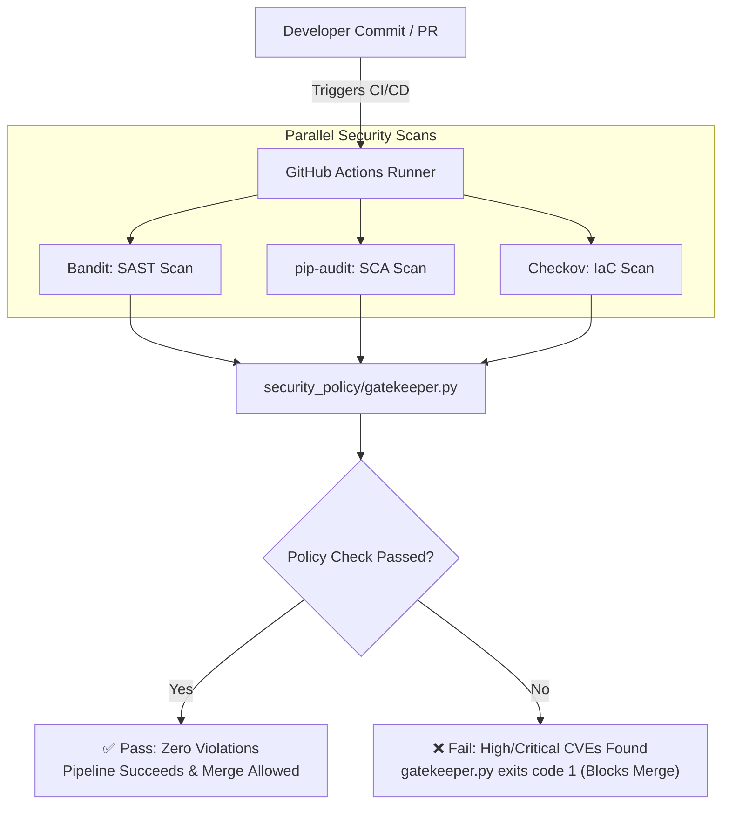
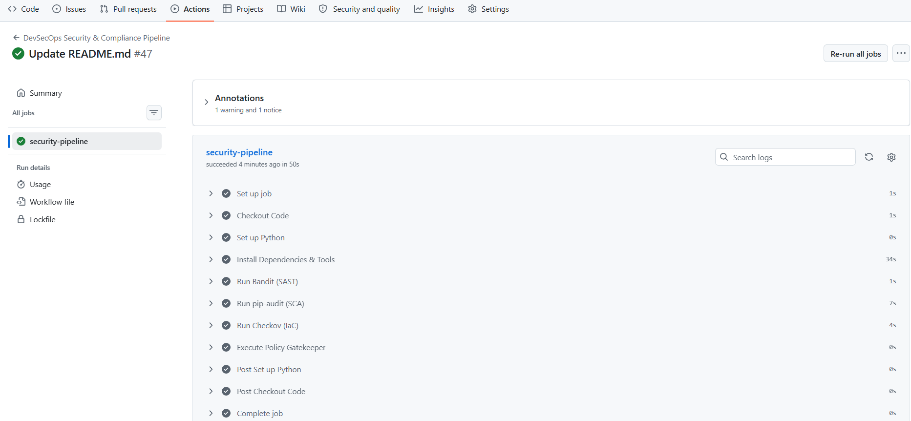

# 🏛️DevSecOps Automated Compliance & Policy Enforcement Pipeline


An enterprise-grade DevSecOps CI/CD security pipeline built with GitHub Actions. This repository demonstrates shifting security left by integrating static application security testing (SAST), software composition analysis (SCA), infrastructure-as-code (IaC) scanning, and custom automated policy gates into continuous deployment workflows.

---

## 🏗️ Architecture & Workflow Overview

The pipeline automatically triggers on code commit or pull request, executing sequential security scans across source code, third-party dependencies, and infrastructure configurations. Findings are passed to an automated policy gate (`gatekeeper.py`) that evaluates risk severity and determines whether to permit or block deployment.



## 🔐 Security Tooling Stack

| Domain | Tool | Description |
| :--- | :--- | :--- |
| **SAST** | [Bandit](https://github.com/PyCQA/bandit) | Analyzes Python source code for security flaws and common vulnerabilities. |
| **SCA** | [pip-audit](https://github.com/pypa/pip-audit) | Scans dependency manifests (`requirements.txt`) against known vulnerability databases (OSV/NVD). |
| **IaC Security** | [Checkov](https://www.checkov.io/) | Evaluates Terraform files (`main.tf`) for compliance and cloud security misconfigurations. |
| **Policy Engine** | `gatekeeper.py` | Custom Python policy gate that inspects project state and blocks non-compliant pipeline deployments. |
---

## 📂 Repository Structure

```text
├── .github/
│   └── workflows/
│       └── security-pipeline.yml
├── app/
│   ├── main.py
│   └── requirements.txt
├── infrastructure/
│   └── main.tf
├── security_policy/
│   └── gatekeeper.py
├── LICENSE
└── README.md             
```

## 🚀 Pipeline Workflow Execution Details

When a developer creates a Pull Request or pushes code to the `main` branch, the `.github/workflows/security-pipeline.yml` workflow executes through the following structured stages:

1. **Environment Setup**
   * Provisions a clean Ubuntu runner with Python 3.10.
   * Installs pipeline security tools and dependencies.

2. **Code Security Analysis (SAST)**
   * **Command:** `bandit -r app/`
   * Scans Python source code to detect security anti-patterns and vulnerabilities.

3. **Dependency Scanning (SCA)**
   * **Command:** `pip-audit -r app/requirements.txt`
   * Checks third-party libraries against known CVE databases (OSV/NVD).

4. **Infrastructure Security Scan (IaC)**
   * **Command:** `checkov -f infrastructure/main.tf`
   * Evaluates Terraform cloud configuration files for security misconfigurations.

5. **Policy Gate Evaluation**
   * **Command:** `python security_policy/gatekeeper.py`
   * Aggregates scan results and enforces hard gate policies (`exit code 1` on High/Critical findings).

---

## 🛠️ Local Execution & Testing

To execute compliance checks locally prior to pushing code:

```bash
git clone [https://github.com/rajeshgurindapalli15-crypto/devsecops-compliance-pipeline.git](https://github.com/rajeshgurindapalli15-crypto/devsecops-compliance-pipeline.git)
cd devsecops-compliance-pipeline
bandit -r app/
pip-audit -r app/requirements.txt
checkov -f infrastructure/main.tf
python security_policy/gatekeeper.py
```
## 🚀 CI/CD Security Pipeline


The automated DevSecOps pipeline performs security checks on every push to `main`:



### Automated Pipeline Steps:
- **Static Application Security Testing (SAST):** Automated Python code analysis.
- **Dependency Vulnerability Scanning:** Scans for known vulnerabilities in requirements.
- **Infrastructure-as-Code (IaC) Audit:** Validates deployment configuration security.
- **Policy Enforcement:** Fails build if critical vulnerabilities are detected.

## 📜 License

This project is licensed under the **MIT License** — see the [LICENSE](LICENSE) file for details.

